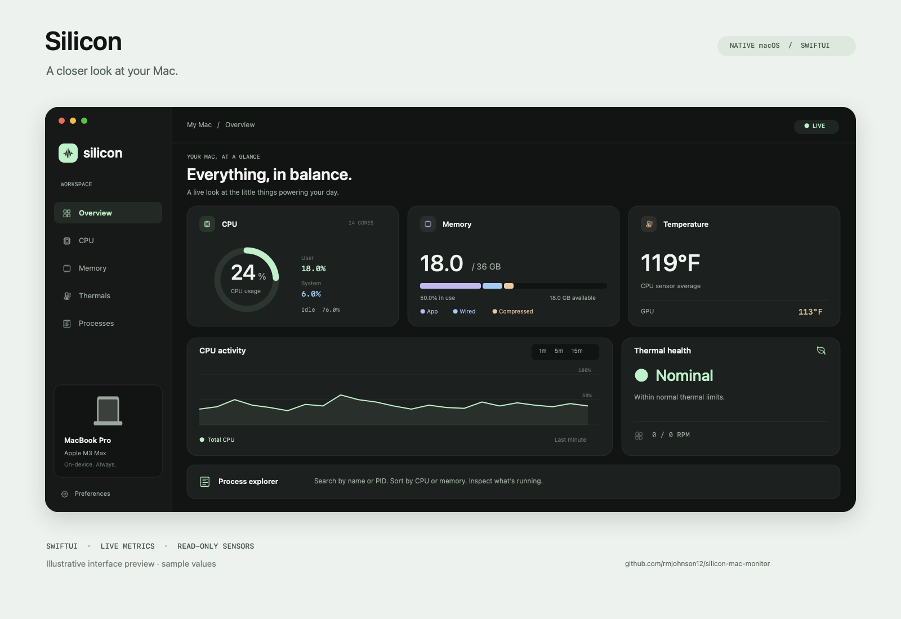

<div align="center">

# Silicon

**A closer look at your Mac.**

A native macOS monitor for CPU, memory, processes, network traffic, temperatures, and fans.
Built with SwiftUI, graphite surfaces, and soft mint accents.

[](https://github.com/rmjohnson12/silicon-mac-monitor/actions/workflows/build.yml)




*Illustrative interface preview with sample values. The running app collects live readings.*

</div>

## What it does

| View | What you can see |
| --- | --- |
| **Overview** | CPU, memory, CPU/GPU temperatures, thermal state, fans, and leading processes |
| **CPU** | Overall user/system utilization, individual cores, and live history |
| **Memory** | App/wired/compressed memory, available memory, cache, swap, and kernel memory pressure |
| **Thermals** | CPU temperature history, available hardware sensors, fan RPM, and macOS thermal pressure |
| **Processes** | Search by name or PID, sort columns, filter CPU users, inspect a process, and reveal its executable in Finder |
| **Network** | Live download/upload Mbps, 1/5/15-minute traffic charts, session transfer totals, connection status, and local IPv4/IPv6 addresses with copy buttons |
| **Menu bar** | A compact stats panel and current CPU usage, available after closing the main window |

Choose a 1-, 2-, or 5-second refresh interval, switch temperature readouts between Celsius and Fahrenheit, pause monitoring, or export a local JSON snapshot. Charts retain up to 15 minutes of collected samples in memory.

## Build and run

Requires **macOS 14 or later**, **Swift 5.9 or later**, and Apple's Command Line Tools or Xcode. There are no third-party Swift package dependencies.

```sh
git clone https://github.com/rmjohnson12/silicon-mac-monitor.git
cd silicon-mac-monitor
./scripts/build-app.sh
open dist/Silicon.app
```

The build script creates a native app bundle with its icon and an ad-hoc signature for local use, plus a versioned ZIP in `dist/` for transferring a test build. This repository distributes source; the app is **not notarized for public binary distribution**. The binary is built for the current Mac's architecture.

To install it, quit Silicon and copy `dist/Silicon.app` into your `~/Applications` folder. You can also use `Launch Silicon.command`, which opens an installed copy or builds and opens the project copy if needed.

## Compatibility

Live hardware validation was performed on a **14-core Apple M3 Max MacBook Pro with 36 GB of unified memory, running macOS 26.7.2**.

The CPU and memory collectors use macOS APIs and discover the machine's core count and physical memory at runtime. Temperature mappings are implemented for the M1, M2, and M3 families, with limited legacy CPU sensor probes. Sensor labels use community mappings and are not guaranteed across models or macOS releases.

A user-reported test on a 2022 13-inch M2 MacBook Pro confirmed CPU/memory/process monitoring plus battery temperature and fan readings. That test identified the missing M2 CPU/GPU mapping in version 1.0. Version **1.0.1** added those keys and re-probes unavailable sensors each interval. Exports from a 2020 M1 MacBook Air (`MacBookAir10,1`) showed battery temperatures but no CPU/GPU readings in both **1.0.1** and **1.0.2**, even after adding the M1 SMC mapping. Version **1.0.3** adds a read-only HID thermal fallback independently for missing CPU/GPU groups. Physical M1/M2 CPU/GPU temperature confirmation is still pending retests; synthetic-response checks do not establish hardware support. Other hardware has not been validated.

Unavailable sensors display **—** or an explicit unavailable message. The confirmed M1 MacBook Air model displays a fanless message when there are no fan readings; missing readings on other models remain labeled unavailable. A successful **0 RPM** reading is retained: some Apple silicon Macs stop their fans when cooling demand is low. Silicon reads fan speeds; macOS manages cooling.

## Understanding the readings

**CPU:** Overall utilization uses Mach per-core tick deltas, normalized to 0–100% across the machine. Process CPU uses `/bin/ps`'s decayed average, where **100% represents one core**; multithreaded processes can exceed 100%. Different scales and averaging windows mean the process figures will not add exactly to overall usage.

**Memory:** Used memory is an approximation of app + wired + physical compressed pages. App memory is anonymous pages minus purgeable pages; available memory includes reclaimable cache. Pressure is read from the kernel. Process memory is resident size (RSS), so shared pages may be counted in multiple processes. Values can differ from Activity Monitor.

**Thermals:** Thermal pressure uses Apple's documented `ProcessInfo.thermalState`. Hardware temperatures and fans use a **read-only AppleSMC connection**. If a CPU/GPU group has no responding SMC sensors, a second read-only reader tries HID thermal services with recognized CPU/GPU product labels. A responding group keeps its SMC readings to avoid counting the same sensors through two interfaces. SOC, battery, enclosure, and unrecognized HID temperatures never substitute for CPU/GPU. Neither reader requires administrator access or a privileged helper. AppleSMC and the HID event calls are undocumented/private interfaces; availability can vary with macOS, and this build is not claimed to satisfy Mac App Store API requirements. CPU/GPU readings are averages of responding sensors, rather than a hottest-core or package-temperature claim. The temperature history chart stays explicitly labeled in Celsius when readouts are set to Fahrenheit.

**Network:** Rates are deltas from the kernel's 64-bit adapter byte counters divided by monotonic elapsed time. The collector uses System Configuration to select Wi-Fi/Ethernet/cellular adapters and checks media link state; it excludes loopback, tunnel, bridge and peer-to-peer interfaces to avoid duplicate traffic accounting. Rates include local-network activity and are **not** negotiated Wi-Fi link speed, per-process traffic, or an internet speed test. Mbps and transfer MB/GB use decimal units. Session totals start at zero on launch and include only observed intervals: the first sample, paused intervals, failed reads, counter resets, newly attached adapters, and gaps longer than 15 seconds cannot add since-boot or unobserved traffic. Charts break across sampling discontinuities. `NWPathMonitor` reports a usable network route, which does not guarantee that a particular internet service is reachable. Unknown hardware link state falls back to the interface's up/running flags.

## Privacy

- Collection and charts run locally. The app has no account, analytics, or network requests.
- Network monitoring reads local adapter counters, addresses, and route state. It does not capture packet contents, look up your public IP, run speed tests, or request location access. Local IP addresses and adapter identifiers stay out of snapshots; only aggregate rates, session totals, adapter count, and generic connection/route status are exported.
- History stays in memory and is discarded when the app quits.
- JSON snapshots are written only when you choose to export them. They include app version, chip/model, OS version, core count, process names, PIDs, resource usage, sensor readings and their SMC/HID source, and omit executable paths, command-line arguments, and the Mac's serial number. Sensor diagnostics include attempted SMC keys, format/read status, HID thermal product labels and available values, and missing temperature groups.
- Build output, local screenshots, exported verification data, and sharing drafts are excluded from version control. The public preview uses sample values.

## Verify

```sh
swift build -c release --build-system native
.build/release/Silicon --self-test
.build/release/Silicon --diagnostics
.build/release/Silicon --network-diagnostics
```

`--self-test` runs **78 regression checks** covering process parsing, multicore CPU values, memory bounds, missing readings, temperature conversion, JSON exports, M1/M2/M3 sensor selection, model identity, fanless classification, zero-RPM handling, sensor recovery, HID label/validity filtering, per-group fallback, diagnostic exports, and network counter math/privacy. Network checks include 64-bit counters, actual sample intervals, idle versus unavailable readings, counter reset, pause, long gaps, failed reads, adapter addition/removal/index reuse, loopback/tunnel exclusion, inactive media, decimal units, and an export allowlist. Sensor-selection checks use synthetic responses and do not calibrate or validate physical sensors. The runner does not require XCTest.

`--network-diagnostics` passively samples local counters twice and prints only the aggregate network export fields. It makes no test connection and exits nonzero if adapter enumeration/counter reads fail. Zero traffic and no active adapters are valid states. Live Wi-Fi rates and local IPv4/IPv6 display were checked on the development M3 Max. Inactive-link and hotplug counter behavior have deterministic coverage; physically switching adapters or disconnecting the network still needs device testing.

`--sensor-diagnostics` prints a sensor-only JSON report and forces a HID probe even when SMC temperatures work. This report includes no process list. Regular UI snapshot exports also include sensor diagnostics for the last completed sample.

`--diagnostics` samples real hardware and exits nonzero if CPU, memory, or process validation fails. It reports the sensors that respond, without requiring sudo or opening a window. Hardware diagnostics are a local check; CI builds the app and runs the deterministic regression checks.

## Keyboard shortcuts

| Shortcut | Action |
| --- | --- |
| `⌘1`–`⌘6` | Change views (Network is `⌘6`; existing shortcuts are retained) |
| `⇧⌘P` | Pause or resume |
| `⌘F` | Search in Processes |
| `⇧⌘E` | Export a snapshot |
| `⌘,` | Open preferences |

## Implementation and attribution

The app uses SwiftUI and Charts for the interface, Mach APIs for CPU/memory counters, `ps` for process sampling, System Configuration/Network for adapter and route state, local kernel counters for traffic, and small C bridges for read-only hardware access. It was developed with assistance from OpenAI Codex.

- [Apple: thermal state](https://developer.apple.com/documentation/foundation/processinfo/thermalstate-swift.enum)
- [Apple: Mach memory statistics](https://developer.apple.com/documentation/kernel/1502863-host_statistics64)
- [SMCKit: SMC protocol reference](https://github.com/beltex/SMCKit)
- [Stats: community sensor identifiers](https://github.com/exelban/stats/blob/master/Modules/Sensors/values.swift)

Third-party attribution and the SMCKit MIT notice are included in [THIRD_PARTY_NOTICES.md](THIRD_PARTY_NOTICES.md).
